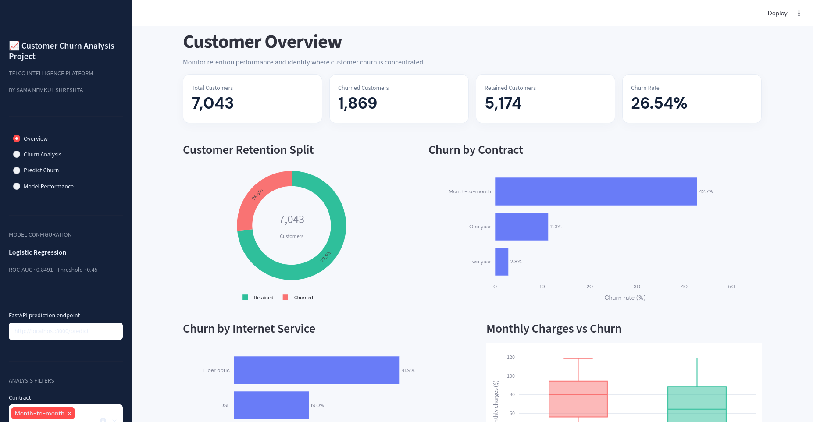
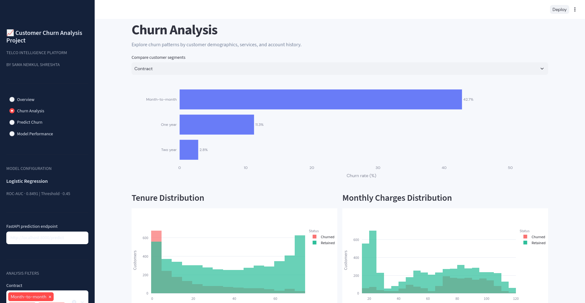
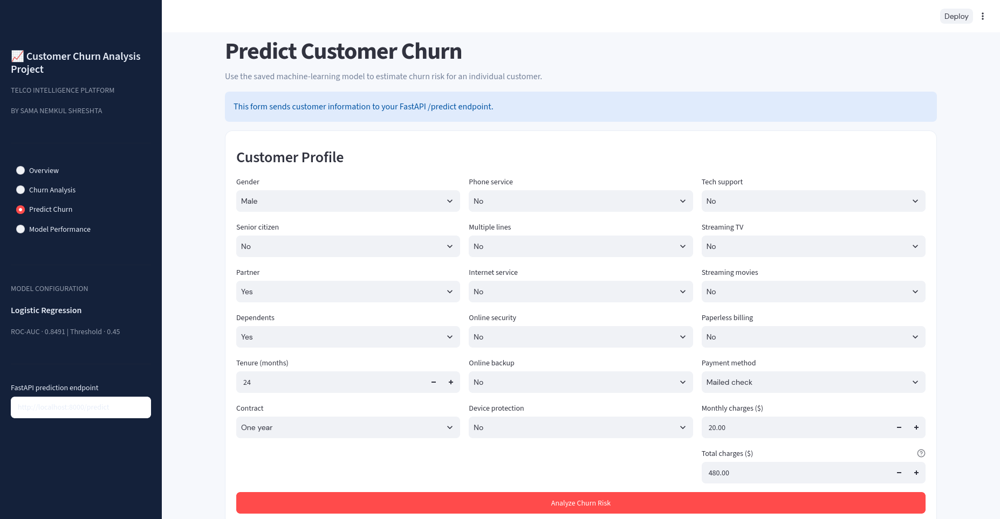
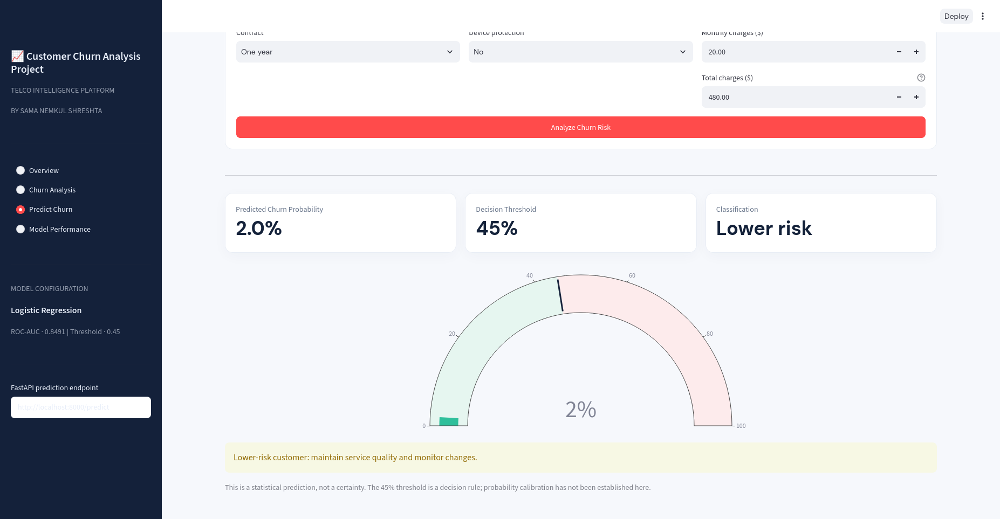

# Customer Churn Prediction System

An end-to-end customer churn analysis and prediction application built with Python, Pandas, Scikit-learn, FastAPI, and Streamlit.

The project analyzes historical telecom customer data, explores patterns associated with customer churn, and uses a trained Logistic Regression model to estimate the probability of an individual customer leaving a service.

It combines exploratory data analysis, machine learning, API development, and interactive data visualization into one application.

---

## Table of Contents

- [Overview](#overview)
- [Project Objectives](#project-objectives)
- [Dataset](#dataset)
- [Exploratory Data Analysis](#exploratory-data-analysis)
- [Machine Learning Model](#machine-learning-model)
- [Application Architecture](#application-architecture)
- [Application Screenshots](#application-screenshots)
- [Technology Stack](#technology-stack)
- [Project Structure](#project-structure)
- [Installation and Setup](#installation-and-setup)
- [Running the Application](#running-the-application)
- [API Documentation](#api-documentation)
- [Prediction Examples](#prediction-examples)
- [Model Limitations](#model-limitations)
- [Future Improvements](#future-improvements)

---

## Overview

Customer churn is a major challenge for subscription-based businesses, particularly in the telecommunications industry.

Understanding why customers leave can help businesses identify potential retention problems and make better decisions about customer engagement.

This project explores customer behavior using the IBM Telco Customer Churn dataset and develops a machine learning application capable of estimating customer churn probability.

The application provides two primary capabilities:

1. **Customer Analytics:** An interactive dashboard for exploring customer demographics, service subscriptions, contract types, billing patterns, and churn distribution.
2. **Churn Prediction:** An individual customer prediction interface that communicates with a FastAPI backend and returns a churn probability using a trained machine learning model.

The goal is to demonstrate a complete workflow, from understanding historical data to integrating a machine learning model into a usable application.

## Project Objectives

- Explore and understand customer churn patterns.
- Perform data cleaning and exploratory data analysis.
- Identify customer segments associated with higher churn rates.
- Develop a machine learning classification model.
- Evaluate model performance using classification metrics.
- Save and reuse the trained model.
- Develop a REST API for generating predictions.
- Integrate the API with an interactive Streamlit dashboard.
- Present prediction probabilities in an understandable format.

## Dataset

This project uses the **IBM Telco Customer Churn dataset**, an expanded telecom customer dataset containing 7,043 customer records and 33 columns.

The dataset includes information about:

| Category | Description |
|---|---|
| Customer Information | Customer ID, gender, senior citizen status |
| Demographics | Partner and dependent information |
| Account Information | Tenure, contract type, billing details |
| Services | Phone, internet, security, backup, streaming services |
| Charges | Monthly charges and total charges |
| Churn Information | Churn label, churn value, churn score, churn reason |
| Customer Value | Customer lifetime value (CLTV) |

### Dataset Summary

| Metric | Value |
|---|---:|
| Total Customers | 7,043 |
| Churned Customers | 1,869 |
| Retained Customers | 5,174 |
| Overall Churn Rate | 26.54% |

### Target Variable

The model uses `Churn Value` as its target variable:

- `1` — Customer churned.
- `0` — Customer remained.

The original dataset is retained, while the necessary transformations are performed during data preparation.

**Note:** The dataset is not included in this repository. Place the Excel file in the following location before running the analytics dashboard:

```text
dataset/
└── Telco_customer_churn.xlsx
```

## Exploratory Data Analysis

Exploratory Data Analysis (EDA) was performed to understand customer characteristics and identify patterns associated with churn.

The analysis focuses on:

- Customer retention and churn distribution.
- Churn rates across different contract types.
- Churn behavior across internet service categories.
- Monthly charges and their relationship with churn.
- Customer tenure distribution.
- Payment methods and service subscriptions.
- Demographic and account-related customer segments.

### Key Findings

Some notable observations from the analysis include:

| Customer Segment | Churn Rate |
|---|---:|
| Month-to-month Contract | 42.71% |
| One-year Contract | 11.3% |
| Two-year Contract | 2.8% |
| Electronic Check Payment | 45.29% |
| Fiber Optic Internet | 41.89% |
| Senior Citizens | 41.68% |

Additional observations:

- Customers with month-to-month contracts demonstrate substantially higher churn.
- Customers using electronic checks have a higher churn rate than other payment segments.
- Fiber optic customers exhibit a relatively high churn rate.
- Churned customers have higher average monthly charges than retained customers.

These findings are descriptive observations from the dataset, not evidence that any single factor directly causes churn.

## Machine Learning Model

A Logistic Regression classification model was developed to estimate customer churn probability.

The trained model and its preprocessing pipeline are saved together as a reusable model artifact.

### Model Configuration

| Component | Configuration |
|---|---|
| Algorithm | Logistic Regression |
| Problem Type | Binary Classification |
| Preprocessing | Saved preprocessing and model pipeline |
| Model Format | Joblib |
| Evaluation Metric | ROC-AUC |
| ROC-AUC Score | 0.8491 |
| Decision Threshold | 0.45 |

### Prediction Workflow

The prediction process follows these steps:

1. Receive customer information from the application.
2. Convert the input into a structured DataFrame.
3. Map API input fields to the feature names expected by the trained model.
4. Pass the data through the saved preprocessing and classification pipeline.
5. Calculate the probability of customer churn.
6. Apply the decision threshold.
7. Return the prediction and probability to the application.

### Decision Threshold

The application currently uses a threshold of `0.45`.

| Churn Probability | Classification |
|---|---|
| Below 45% | Lower Risk |
| 45% or Above | At Risk |

The threshold is a classification decision rule. It does not mean that a probability of 45% guarantees that a customer will churn.

### Understanding ROC-AUC

The model achieved a ROC-AUC score of **0.8491**.

ROC-AUC evaluates how effectively a classification model distinguishes between positive and negative classes across different classification thresholds.

This score indicates promising discrimination performance on the evaluation data. It should not be interpreted as 84.91% prediction accuracy.

## Application Architecture

The project uses a two-part application architecture:

- **Frontend:** Streamlit provides the interactive analytics dashboard and customer prediction interface.
- **Backend:** FastAPI exposes the prediction endpoint and communicates with the saved machine learning model.

### Architecture Diagram

```text
                 USER
                   |
                   v
          STREAMLIT DASHBOARD
               :8501
                   |
          Customer Information
                   |
                   v
             FASTAPI SERVER
               :8000
                   |
                   v
          POST /predict
                   |
                   v
           PREDICTOR MODULE
                   |
                   v
        SAVED ML MODEL PIPELINE
                   |
                   v
          CHURN PROBABILITY
                   |
                   v
          THRESHOLD ANALYSIS
                   |
                   v
          JSON API RESPONSE
                   |
                   v
          STREAMLIT RESULTS
```

### Main Components

**1. Streamlit Dashboard — `app/dashboard.py`**

Responsible for:

- Customer overview and retention metrics.
- Interactive churn analysis.
- Customer segmentation filters.
- Data visualizations.
- Customer prediction form.
- Prediction probability and risk visualization.

**2. FastAPI Backend — `app/main.py`**

Responsible for:

- Defining the REST API.
- Validating incoming customer information using Pydantic.
- Receiving prediction requests.
- Passing customer data to the predictor module.
- Returning prediction results as JSON.

**3. Prediction Module — `app/predictor.py`**

Responsible for:

- Loading the saved machine learning model.
- Mapping incoming API fields to the model's expected feature names.
- Generating churn probabilities.
- Applying the classification threshold.
- Returning structured prediction results.

**4. Model Artifacts — `artifacts/`**

Contains the saved model and associated metadata:

```text
artifacts/
├── churn_model.joblib
└── model_metadata.joblib
```

## Application Screenshots

The application currently includes an interactive customer analytics dashboard and an individual churn prediction interface.

### 1. Customer Overview

Displays the overall customer population, churn distribution, retention metrics, and major churn patterns.



### 2. Churn Analysis

Explores customer churn across different segments, including contract types, services, tenure, and monthly charges.



### 3. Customer Churn Prediction

Allows users to enter customer information and submit it to the FastAPI prediction endpoint.



### 4. Prediction Results

Displays the estimated churn probability, decision threshold, classification, and visual risk indicator.



## Technology Stack

| Technology | Purpose |
|---|---|
| Python | Primary programming language |
| Pandas | Data manipulation and analysis |
| NumPy | Numerical operations |
| Scikit-learn | Machine learning and preprocessing |
| Joblib | Model serialization |
| Plotly | Interactive visualizations |
| Streamlit | Interactive frontend and dashboard |
| FastAPI | Backend REST API |
| Pydantic | API input validation |
| Uvicorn | ASGI server |
| OpenPyXL | Excel dataset loading |

## Project Structure

```text
Customer-Churn-Prediction-System/
│
├── app/
│   ├── __init__.py
│   ├── dashboard.py
│   ├── main.py
│   └── predictor.py
│
├── artifacts/
│   ├── churn_model.joblib
│   └── model_metadata.joblib
│
├── dataset/
│   └── Telco_customer_churn.xlsx
│
├── screenshots/
│   ├── customer_overview.png
│   ├── churn_analysis.png
│   ├── predict.png
│   └── predict2.png
│
├── tests/
│   └── test_predictor.py
│
├── requirements.txt
└── README.md
```

*The dataset directory is required locally but is not included in the repository.*

## Installation and Setup

### Prerequisites

- Python 3.11 or later.
- pip.
- Git.

### 1. Clone the Repository

```bash
git clone https://github.com/samanemkul/Customer-Churn-Prediction-System.git
```

Navigate into the project directory:

```bash
cd Customer-Churn-Prediction-System
```

### 2. Create a Virtual Environment

```bash
python -m venv .venv
```

Activate the environment.

**Linux / macOS:**

```bash
source .venv/bin/activate
```

**Windows:**

```bash
.venv\Scripts\activate
```

### 3. Install Dependencies

```bash
pip install -r requirements.txt
```

### 4. Add the Dataset

Create a `dataset` directory if it does not already exist:

```bash
mkdir -p dataset
```

Place the original Excel dataset inside it:

```text
dataset/Telco_customer_churn.xlsx
```

The dashboard uses this file for customer analytics.

## Running the Application

The frontend and backend run as separate processes.

Open two terminal windows from the project directory.

### Terminal 1: Start FastAPI

Activate the virtual environment and run:

```bash
python -m uvicorn app.main:app --reload --port 8000
```

The API will be available at:

```text
http://localhost:8000
```

### Terminal 2: Start Streamlit

Activate the same virtual environment and run:

```bash
streamlit run app/dashboard.py
```

The dashboard will be available at:

```text
http://localhost:8501
```

Once both services are running, open the Streamlit dashboard and navigate to **Predict Churn** to submit customer information.

## API Documentation

FastAPI automatically generates interactive API documentation.

**Swagger UI:**

```text
http://localhost:8000/docs
```

**Alternative API documentation:**

```text
http://localhost:8000/redoc
```

### Prediction Endpoint

| Property | Value |
|---|---|
| Method | POST |
| Endpoint | `/predict` |
| Content-Type | `application/json` |
| Response | JSON |

### Example Request

```json
{
  "gender": "Male",
  "SeniorCitizen": "No",
  "Partner": "Yes",
  "Dependents": "No",
  "tenure": 12,
  "PhoneService": "Yes",
  "MultipleLines": "No",
  "InternetService": "Fiber optic",
  "OnlineSecurity": "No",
  "OnlineBackup": "Yes",
  "DeviceProtection": "No",
  "TechSupport": "No",
  "StreamingTV": "Yes",
  "StreamingMovies": "Yes",
  "Contract": "Month-to-month",
  "PaperlessBilling": "Yes",
  "PaymentMethod": "Electronic check",
  "MonthlyCharges": 85.5,
  "TotalCharges": 1026.0
}
```

### Example Response

```json
{
  "prediction": 1,
  "churn_probability": 0.771695859716365,
  "risk_level": "High",
  "threshold": 0.45
}
```

In this example, the model estimates a churn probability of approximately 77.17%.

Since this exceeds the 45% decision threshold, the customer is classified as high risk.

## Prediction Examples

The integrated application was manually tested using three different customer profiles.

| Test Case | Customer Profile | Churn Probability | Classification |
|---|---|---:|---|
| Test 1 | Short tenure, month-to-month, fiber optic, electronic check | 77.2% | At Risk |
| Test 2 | Long tenure, two-year contract, multiple support services | 0.5% | Lower Risk |
| Test 3 | No phone or internet service, one-year contract | 2.0% | Lower Risk |

These tests confirm that the tested customer profiles successfully pass through the Streamlit interface, FastAPI endpoint, and saved model pipeline.

They are functional integration tests, not a substitute for evaluating predictive performance on an independent test dataset.

## Model Limitations

Although the application demonstrates a complete prediction workflow, there are several limitations to consider:

- The model is trained using historical telecom customer data.
- Historical patterns may not represent current customer behavior.
- The decision threshold is configurable and should be evaluated against business requirements.
- Probability calibration has not yet been established.
- The model's predictions should not be interpreted as certainty.
- The application has not been validated as a production system for a live telecom operator.

The model should be evaluated further using a confusion matrix, precision, recall, F1-score, precision-recall analysis, and probability calibration before being used for operational retention decisions.

## Future Improvements

Potential areas for further development include:

- Add comprehensive automated tests for the prediction module and API.
- Evaluate additional classification algorithms.
- Perform systematic hyperparameter tuning.
- Analyze feature importance and model coefficients.
- Improve probability calibration.
- Evaluate different classification thresholds.
- Add model explainability using SHAP.
- Introduce customer-level retention recommendations.
- Add model monitoring and prediction logging.
- Deploy the application to a cloud environment.
- Improve API security and production configuration.

---

## Author

**Sama Nemkul Shresta**

GitHub: [@samanemkul](https://github.com/samanemkul)

---

*This project was developed as a practical exploration of data science, machine learning, and application development using real-world-style customer data.*